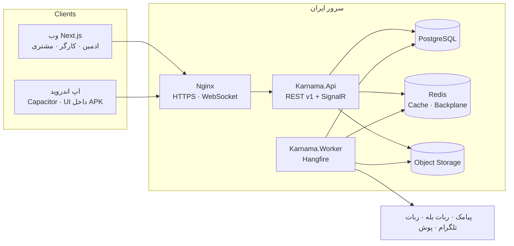
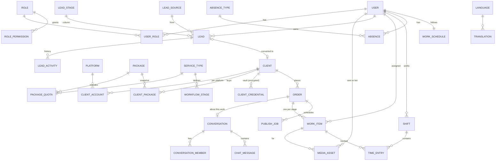
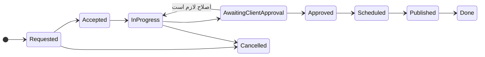
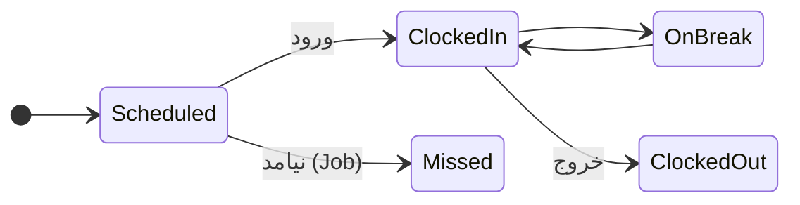
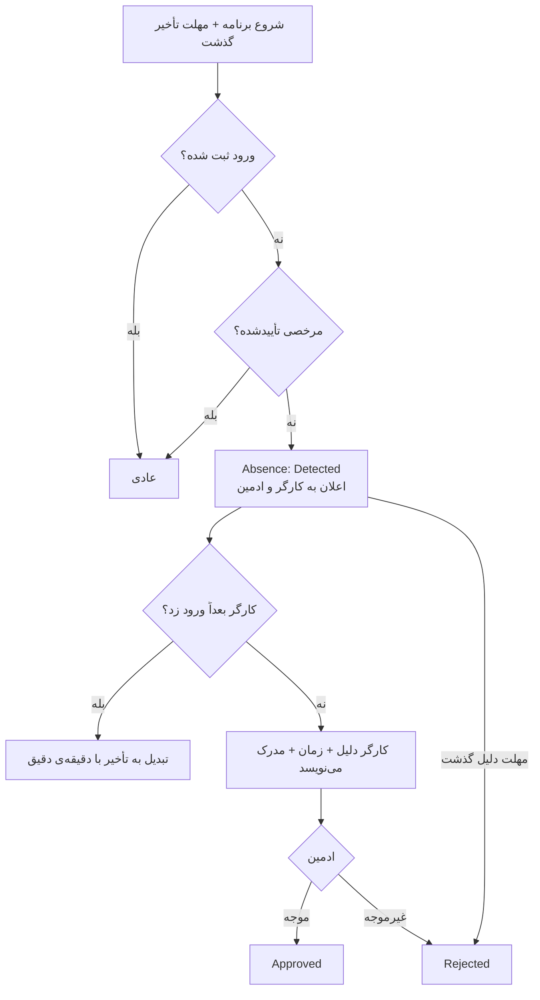

# نقشه‌ی پروژه — کارنما

> **هر جلسه اول فقط همین فایل را بخوان.** بعد از هر کار به‌روزش کن و `python tools/build_map.py` بزن.
> آخرین به‌روزرسانی: ۳ آبان ۱۴۰۵ — وضعیت: **دمو ✅ + M5 ✅ + M6 ✅ + N9 ✅ + N10 ✅ + M7 ✅ (فاز ۱ کامل) + N4 ✅ + N5 ✅ + N6 ✅ + N7 ✅ + N8 ✅ — بعدی: N3 (تجهیزات) و N12 (راهنما)؛ N2 و N11 منتظر جواب سؤال‌های بخش ۱۷**

## وضعیت مراحل

| مرحله | عنوان | فاز قرارداد | وضعیت |
|---|---|---|---|
| M0 | پرامپت، اسکیل‌ها، نقشه، اسکلت پوشه | — | ✅ انجام شد |
| M1 | اسکلت + Auth + نقش‌های دینامیک + زیرساخت زبان + CI | کنترل داخلی | ✅ انجام شد |
| M2 | داده‌ی پایه + CRUD ادمین + پکیج‌های فروش | کنترل داخلی | ✅ انجام شد |
| M3 | سفارش، کار، کانبان لایو، آپلود قابل ادامه | کنترل داخلی | ✅ انجام شد |
| M4 | ساعت کار دقیق (شیفت، تایمر، آفلاین، اصلاح) | کنترل داخلی | ✅ انجام شد |
| M6 (بخش) | پورتال ساده‌ی مشتری برای دمو | کنترل داخلی | ✅ نسخه‌ی ساده |
| M5 | غیبت، مرخصی، تأخیر | کنترل داخلی | ✅ انجام شد |
| M6 | پورتال مشتری، انتشار، اعلان‌ها و ربات‌ها | کنترل داخلی | ✅ انجام شد (Gateway تلگرام در N5) |
| M7 | اندروید، ۱۰ اسکیل امنیتی، k6، 3G، دیپلوی ایران | کنترل داخلی ← **تحویل فاز ۱** | ✅ (APK در Android Studio امیر ساخته می‌شود؛ k6 روی سرور آزمایشی) |
| M8 | زبان‌ها، تبلیغات، گزارش ماهانه، صفحه‌ی عمومی | برنامه‌ی کامل | ⬜ |
| M9 | گزارش‌ها و داشبوردها | برنامه‌ی کامل | ⬜ |
| M10 | انتشار خودکار بله/تلگرام، پرداخت قرارداد، سود مشتری | برنامه‌ی کامل | ⬜ |

## M1 — چه ساخته شد

- **بک‌اند (.NET 10 LTS):** `Karnama.Domain / Application / Infrastructure / Api / Worker`، PostgreSQL (EF Core + Npgsql، `xmin`)، Redis (اختیاری در Development، اجباری در Production).
- **ورود:** موبایل + OTP (HMAC، ۲ دقیقه، ۵ تلاش اتمیک، ۳ ارسال/۱۰ دقیقه، ۶۰ ثانیه فاصله، ارسال پیامک در صف پس‌زمینه)، JWT ۱۵ دقیقه، Refresh چرخشی با تشخیص استفاده‌ی مجدد (وب: کوکی HttpOnly؛ اندروید: هدر `X-Refresh-Token`)، **۲FA اجباری مالک (TOTP)**، ورود سریع دمو (فقط Development).
- **نقش‌ها و مجوزها:** کاتالوگ ۲۹ مجوز با دامنه‌ی Own/Assigned/All، نقش‌های سیستمی مالک/مشتری، CRUD نقش‌ها با حذف نرم، برگرداندن، همزمانی (409)، Audit تغییرناپذیر (Trigger)، اعلان لایو تغییر نقش با SignalR (MessagePack).
- **چندزبانه:** جدول `Languages` و `Translations`، `/api/v1/i18n/{code}` با ETag/304، فارسی پیش‌فرض داخل باندل، انگلیسی lazy، تغییر `dir` بدون رفرش، تاریخ شمسی و ارقام فارسی.
- **راه‌اندازی:** `/setup` با کد نصب (ثابت‌زمان، تراکنشی، فقط یک بار، در نصب دمو رد می‌شود).
- **فرانت (Next.js 16):** `/login`، `/setup`، `/dashboard`، `/roles` (جدول دسکتاپ + کارت موبایل + Sheet فرم + تأیید حذف داخل صفحه + برگرداندن ۱۰ ثانیه‌ای)، `/profile` (زبان، تم روشن/تیره)، ۴۰۴، نوار آفلاین، نوار دمو + تغییر نقش، سایدبار جمع‌شونده + Bottom Nav. خروجی استاتیک اندروید (`npm run build:mobile`) هم build می‌شود.
- **تست:** ۳۴ Unit + ۲۲ Integration (PostgreSQL واقعی؛ Testcontainers یا `KARNAMA_TEST_PG`) + ۱۶ سناریوی تصویری Playwright روی ۱۳۶۶ / Pixel 7 / ۳۶۰px (`tests/e2e/run-visual.sh`).
- **CI:** `.github/workflows/ci.yml` (build، test، پکیج آسیب‌پذیر، npm audit، lint، type، بودجه‌ی JS، build اندروید) و `codeql.yml`.
- **امنیت:** `docs/security/2026-10-25-m1-review.md` — ۴ Medium و ۴ Low پیدا و اصلاح شد.
- **White-label (خواسته‌ی امیر):** صفحه‌ی «برند و ظاهر» (نام، شعار، لوگو با بررسی Magic Bytes، رنگ اصلی/تیره/تأکید با تضمین خوانایی WCAG، پیش‌نمایش زنده) و «متن‌های سایت» (هر متن هر زبان، جستجو، برگرداندن به پیش‌فرض). رنگ پیش‌فرض: مشکی `#0A0A0A` + زرد `#FEFF00` (پرامپت دوم).
- **آیفون (PWA):** manifest دینامیک از برند، Service Worker (پوسته‌ی آفلاین، API هرگز کش نمی‌شود)، آیکون‌ها، راهنمای «Add to Home Screen». نقشه‌ی کامل موبایل: `docs/MOBILE.md`.
- **بودجه‌ی JS:** tailwind-merge (~۹KB) با یک `cn` یک‌کیلوبایتی جایگزین شد (تست هم‌خوانی: `scripts/cn-parity.mts`) → همه‌ی صفحه‌ها ۱۶۸–۱۷۵KB.

## M2 — چه ساخته شد

- **بک‌اند:** کاربران (قانون «آخرین مالک»، فقط مالک نقش مالک می‌دهد، دمو فقط داده‌ی دمو)، شبکه‌ها (۵ شبکه‌ی پیش‌فرض)، انواع خدمت (فرم‌ساز ۱۱ نوع فیلد با نسخه‌بندی فقط هنگام تغییر واقعی + مراحل کار)، پکیج‌ها (قیمت ریالی long، تخفیف بازه‌دار، سهمیه، ظرفیت با تخصیص Serializable، توضیحات Markdown با Sanitize، سئو، کاور با Magic Bytes)، مشتری‌ها (موبایل فقط با `clients.contact`، پیج‌ها، تخصیص پکیج با Snapshot قیمت/سهمیه، لغو، دسترسی پنل مشتری)، تاریخچه از Audit، دستیار راه‌اندازی، خروجی Excel (ضد Formula Injection).
- **فرانت:** `/users`، `/clients`، `/packages`، `/services`، `/settings/platforms` با یک `CrudList` مشترک (جستجو، صفحه‌بندی Keyset، حذف‌شده‌ها، Excel، تاریخچه، حذف با تأیید + برگرداندن ۱۰ ثانیه‌ای، جدول دسکتاپ/کارت موبایل)؛ ویرایشگرها lazy در Sheet (پایین صفحه روی گوشی)؛ ورود تاریخ شمسی (`lib/jalali.ts`)، مبلغ به تومان؛ کارت «راه‌اندازی قدم‌به‌قدم» روی داشبورد؛ متن‌های راهنما زیر هر فیلد (`fa-m2-forms.ts`، lazy با ویرایشگرها).
- **باگ پیدا و اصلاح شد:** فیلتر enum در Query String حساس به حروف بود (`?status=active` → 400) → پارس بدون حساسیت؛ ادمین بدون `clients.contact` نمی‌توانست مشتری را ذخیره کند.
- **تست:** ۳۹ Unit + ۳۰ Integration + ۲۴ سناریوی تصویری (۳ دستگاه، شامل سناریوی کامل M2: خدمت ← پکیج ← مشتری ← تخصیص ← حذف/برگرداندن ← همکار ← شبکه).
- **بودجه‌ی JS:** همه‌ی صفحه‌ها ۱۶۹–۱۸۰KB (لیست‌ها نزدیک سقف؛ M3 باید کانبان را lazy کند).

## M3 و M4 و پورتال — چه ساخته شد

- **سفارش:** شماره‌ی ترتیبی (Sequence)، فرم همان نسخه‌ی خدمت، مصرف سهمیه‌ی پکیج (Serializable؛ تمام شد ← «خارج از پکیج» با قیمت پایه)، پذیرش/رد/لغو، ثبت از پورتال مشتری (همیشه «منتظر بررسی»).
- **کار (WorkItem):** یک کارت برای هر مرحله؛ مرحله‌ی بعد فقط بعد از «انجام شد» باز می‌شود؛ قانون جابه‌جایی در Domain (`WorkItem.CanMoveTo`): کارگر شروع/تحویل، مدیر بازبینی/اصلاح/هرجا، مشتری تأیید/اصلاح. پیشنهاد کارگر (نقش مرحله + کمترین حجم کار باز). پیام داخلی و پیام مشتری جدا. رفتن به «منتظر تأیید مشتری» = فایل‌های تحویلی آن مرحله برای مشتری باز می‌شود.
- **لایو:** یک اتصال SignalR برای همه‌چیز (به‌جای سه Hub — باتری و داده‌ی کمتر)؛ پیام‌ها فقط `{seq, kind, id, fields}`؛ جدول `change_events` = Change Cursor و `GET /api/v1/changes?since=` بعد از قطع اتصال؛ گروه‌ها: `work:all`، `presence:all`، `user:{id}`، `client:{id}`.
- **فایل:** آپلود تکه‌ای قابل ادامه (شبیه tus: POST ← PATCH با `Upload-Offset` ← GET وضعیت)، تا ۲GB، تکه‌های ۸MB، ادامه بعد از قطع اینترنت یا بستن صفحه؛ نوع از Magic Bytes (HTML/SVG/اجرایی رد)؛ ذخیره بیرون از وب‌روت؛ دانلود با بررسی دسترسی.
- **حضور (M4 + N1):** شیفت با ساعت سرور، استراحت، تأخیر/زودرفتن از برنامه‌ی کاری (هفته‌ی ایرانی، Asia/Tehran)، قانون ورود ترکیبی (`OfficeNetwork & (RotatingQr | BiometricDevice)`)، QR چرخان HMAC هر ۳۰ ثانیه و یک‌بارمصرف، موقعیت فقط لحظه‌ی ورود (مکان جعلی = قرمز)، شکست = «نیاز به بررسی» نه رد، ثبت آفلاین با Idempotency-Key و زمان سپری‌شده، یک تایمر روشن (ایندکس یکتا)، درخواست اصلاح (تأیید مدیر دیگر)، رویدادها Append-only (Trigger)، Job بستن شیفت فراموش‌شده، حضور زنده‌ی تیم، صفحه‌ی QR دفتر، تنظیمات کامل.
- **پورتال ساده:** پکیج و سهمیه‌ی مصرف‌شده، «منتظر تأیید شما»، سفارش‌ها با درصد پیشرفت و وضعیت به زبان ساده، سفارش جدید با فرم خدمت، پیام‌ها (کارکنان با نام «آژانس»).
- **تست:** ۴۸ Unit + ۴۵ Integration + ۳۷ سناریوی تصویری (۳ دستگاه) شامل «تغییر لایو بدون رفرش».
- **امنیت:** `docs/security/2026-10-25-m3-m4-review.md` — ۱ High، ۳ Medium، ۴ Low پیدا و اصلاح شد.
- **راهنمای دمو:** `docs/DEMO.md`.

## M5 — چه ساخته شد

- **انواع مرخصی (دینامیک):** با/بی‌حقوق، نیاز به مدرک، سقف سالانه، رنگ؛ پیش‌فرض‌ها (استحقاقی ۲۶ روز، استعلاجی، ماموریت، غیبت موجه، بدون حقوق).
- **درخواست از قبل:** روزانه یا ساعتی، دلیل اجباری، هم‌پوشانی رد، لغو قبل از شروع؛ اعلان لایو به مدیر؛ تأیید/رد (نه برای خود)؛ بعد از تأیید، فهرست کارهای ددلاین‌دار آن بازه برای سپردن دوباره. مدیر می‌تواند برای همکاری که تلفنی خبر داده ثبت کند (فوراً تأیید).
- **غیبت اعلام‌نشده:** Job هر ۵ دقیقه (`detect-absences`)؛ ورود بعدی = تبدیل به تأخیر با دقیقه‌ی دقیق؛ ثبت دلیل بعد از واقعه؛ بدون دلیل تا مهلت (پیش‌فرض ۴۸ ساعت، از پنل) = غیرموجه خودکار.
- **مانده‌ی مرخصی** از درخواست‌ها (سال شمسی)، **تقویم حضور تیم** (ماه شمسی، رنگی)، **گزارش حقوق** (ساعت کار، تأخیر، زودرفتن، مرخصی با/بی‌حقوق، غیبت‌ها) + Excel.
- **کارایی:** React Query حذف شد (`lib/query.ts`) → همه‌ی صفحه‌ها ۱۵۹–۱۷۰KB.
- **تست:** ۴۸ Unit + ۴۶ Integration + ۴۰ سناریوی تصویری. امنیت: `docs/security/2026-10-25-m5-review.md`.

## M6 — چه ساخته شد

- **اعلان‌ها:** زنگوله در بالای همه‌ی صفحه‌ها (لایو + هر دقیقه برای Job‌های Worker)، Toast برای اعلان تازه، «همه خوانده شد». Transactional Outbox: هر اعلان در همان تراکنش تغییر ثبت می‌شود و `OutboxDispatcher` در Worker می‌فرستد (Lease، Backoff ۱→۲→۴… دقیقه، ۸ تلاش).
- **کانال‌ها:** داخل برنامه (همیشه)، بله (Bot API مستقیم)، تلگرام (از طریق Gateway امضاشده)، پیامک فقط برای موارد مهم؛ ساعت سکوت (پیش‌فرض ۲۲ تا ۸) — مهم‌ها فوری. تنظیمات در «حساب من».
- **اتصال ربات:** دکمه‌ی «اتصال» → لینک `ble.ir/<bot>?start=<کد>` → ربات چت را وصل می‌کند؛ `/stop` قطع. وبهوک: `POST /api/v1/bots/bale/{secret}`، Gateway: `POST /api/v1/bots/telegram` با HMAC.
- **تقویم انتشار** (`/publishing`): هفته‌ی شنبه تا جمعه، فیلتر مشتری، زمان‌بندی پست (پیج، روز و ساعت، سفارش، فایل‌های تحویلی، کپشن، هشتگ)، «منتشر شد» + لینک، لغو؛ از برگه‌ی سفارش هم «زمان‌بندی انتشار». Job هر دقیقه: سر وقت یادآوری، ۲ ساعت بعد «عقب افتاده» + خبر به مدیر.
- **پورتال:** «پست‌هایی که باید خودتان منتشر کنید» (دانلود فایل، کپی کپشن و هشتگ، «منتشر کردم» + لینک)، پیام مشتری به آژانس روی هر سفارش؛ جواب ادمین (پیام «برای مشتری» روی کارت کار) به زنگوله‌ی مشتری می‌رسد.
- **پیام انقضای پکیج** ۷، ۳ و ۱ روز مانده (Job روزانه ۹ صبح تهران).
- **اصلاحات جانبی:** تاریخ با ساعت در فارسی ساعت را نشان نمی‌داد (درست شد)؛ Select اجباری خالی حالا «انتخاب کنید…» نشان می‌دهد؛ «به‌زودی» داشبورد و قدم «برنامه‌ی کاری» راه‌اندازی به‌روز شد.
- **تست:** ۵۲ Unit + ۵۰ Integration + ۴۳ سناریوی تصویری. امنیت: `docs/security/2026-10-25-m6-review.md`.
- **تنظیمات لازم برای سرور واقعی (env):** `Messengers__BaleToken`، `Messengers__BaleWebhookSecret`، `Notify__BaleBotUsername`، `Notify__PublicBaseUrl`، `Sms__LineNumber`؛ تلگرام بعد از N5: `Messengers__TelegramGatewayUrl`، `Messengers__TelegramGatewaySecret`، `Notify__TelegramBotUsername`.

## N9 — چه ساخته شد

- **ساختار وب:** `app/(app)` = پنل/ورود/راه‌اندازی (با Providerها)؛ `app/(site)` = سایت عمومی سمت سرور بدون JavaScript برنامه. فایل‌های `*.web.tsx` فقط در بیلد وب و `*.mobile.tsx` فقط در بیلد اپ (`pageExtensions` در `next.config.ts`). عکس‌های `/media/public/*` از طریق rewrite از API.
- **ویرایشگر** (`/content/blog`، Tiptap 3.31.4، MIT): تیتر، لیست، نقل‌قول، عکس (WebP در مرورگر، alt و زیرنویس)، جدول، جعبه‌ی نکته، دکمه‌ی دعوت، جداکننده؛ میان‌بُر مارک‌داون و چسباندن مارک‌داون (تبدیل در سرور).
- **سئوی خودکار** (`SeoAutomation` + `TiptapRenderer`): عنوان، توضیح، نامک فارسی یکتا + ۳۰۱، کلمه‌ی کلیدی، alt، فهرست، زمان مطالعه، FAQ، چک‌لیست با امتیاز، پیشنهاد لینک داخلی؛ قفل فیلد دستی. جزئیات: `docs/SEO.md`.
- **جریان:** نویسنده (`blog.write:Own`) پیش‌نویس → بازبینی؛ ویراستار (`blog.publish`) انتشار/زمان‌بندی (Job هر دقیقه)/برگرداندن/بایگانی؛ دسته‌ها.
- **سایت:** `/blog` (دسته، صفحه‌بندی)، `/blog/[slug]` (JSON-LD، canonical، OG، فهرست، مطالب مرتبط، اشتراک تلگرام/واتساپ)، `/og/blog/[slug]` (عکس اشتراک خودکار با حروف فارسی درست)، `sitemap.xml`، `robots.txt`؛ متن‌های سایت در «متن‌های سایت» قابل ویرایش.
- **تست:** ۵۵ Unit + ۵۲ Integration + ۴۹ سناریوی تصویری. امنیت: `docs/security/2026-10-25-n9-review.md`.
- **کارایی:** ۴۰۴ سمت سرور و بدون Provider → همه‌ی صفحه‌ها ۱۵۶–۱۶۸KB؛ صفحه‌ی اصلی ۱۳۷KB.

## M7 — چه ساخته شد (تحویل فاز ۱)

- **اپ اندروید** (`mobile/`، Capacitor 8.5.3): Keystore برای توکن، GPS + تشخیص مکان جعلی، اسکنر QR گوشی، دکمه‌ی برگشت، یادآوری محلی زمان انتشار، آیکون/اسپلش از برند (`tools/android_assets.py`)، امنیت MASVS. ساخت: `build-android.cmd` (جزئیات `docs/MOBILE.md`).
- **دانلود امضاشده** ۱۰ دقیقه‌ای با Range برای همه‌ی فایل‌ها (وب و اپ).
- **دیپلوی:** Dockerfileها، `deploy/docker-compose.prod.yml` (Caddy با TLS، migrate با اسکریپت idempotent)، بکاپ روزانه و تست بازگردانی ماهانه، `deploy/README.md`.
- **کارایی:** تابلوی کار ۳ برابر سریع‌تر؛ تست 3G سبز؛ اسکریپت k6 هزار کاربر.
- **تست:** ۵۵ Unit + ۵۵ Integration + تست تصویری (وب + خروجی اپ + 3G). امنیت: `docs/security/2026-10-25-m7-review.md`.

## N10 — چه ساخته شد

- **سایت عمومی (SSR):** `/` (هیرو، اعداد واقعی، خدمات، نمونه‌کارها، پکیج‌ها، روند همکاری، نظر مشتری، آخرین مطالب، FAQ، فرم مشاوره، تماس و نشان/بلد)، `/plans` و `/plans/[slug]` (پکیج با قیمت تومان، `Service`+`Offer`+`FAQPage`)، `/cases` و `/cases/[slug]`، `/og/site`؛ JSON-LD `Organization`+`ProfessionalService`+`WebSite`.
- **پنل:** «صفحه‌ی اصلی سایت» (`/content/home`، سئوی اجباری با شمارنده و پیش‌نمایش گوگل)، «نمونه‌کارها» (`/content/cases`، ابزار محو اسکرین‌شات در مرورگر، رضایت‌نامه‌ی خصوصی، انتشار فقط با رضایت)، «درخواست‌های مشاوره» (`/leads`، مجوز `leads.manage`).
- **کش:** API پاسخ‌های عمومی را ۳۰ ثانیه کش و با هر تغییر پاک می‌کند (`IPublicCache`)؛ Next هر ۶۰ ثانیه تازه می‌کند.
- **رفع‌ها:** منوی «بیشتر» موبایل اسکرول می‌خورد؛ ویرایشگر بلاگ در ۳۶۰px سرریز نداشت.
- **تست:** ۵۵ Unit + ۵۵ Integration + ۵۵ سناریوی تصویری. امنیت: `docs/security/2026-10-25-n10-review.md`.

## پرامپت دوم (`docs/PROMPT2.md`) — مراحل N1 تا N12

| مرحله | عنوان | وضعیت |
|---|---|---|
| N0 | قانون‌های سراسری: «سایت = وب + اپ»، راهنمای ساده زیر همه‌چیز، **رنگ برند مشکی/زرد**، Audit دیدن داده‌ی حساس | 🟡 رنگ برند اعمال شد (M1)؛ بقیه در هر مرحله |
| N1 | روش‌های ورود و سیاست‌ها (داخل M4) | 🟡 اینترنت دفتر، QR چرخان، موقعیت، تأیید مدیر ✅؛ سلفی/NFC/اثر انگشت با اپ و N2 |
| N2 | دستگاه اثر انگشت (ADMS + فایل) | ⬜ |
| N3 | تجهیزات | ⬜ |
| N4 | پکیج کامل + گاوصندوق رمز + پروفایل مشتری + پیام انقضا (با M2) | ✅ گاوصندوق رمز (AES-256-GCM پوششی، دیدن با OTP، Audit + خبر به مالک، پورتال فقط‌نوشتنی)، پروفایل مشتری + درخواست تمدید، پیام انقضا با روزهای قابل تنظیم + روز آخر + سهمیه + یادآوری رمز در پایان قرارداد |
| N5 | ربات تلگرام (Gateway بیرون ایران) + آداپتر بله | ✅ Gateway جدا (صف دیسکی، امضا، ضد تکرار)، کانال آرشیو، کپی برای ادمین، «برای کدام کار؟»، سپردن از پنل و تلگرام، صندوق فایل‌ها؛ فایل از بله پشت سوئیچ |
| N6 | گفتگو | ✅ دونفره/گروه/کار، صوت و فایل، خوانده‌شده، در حال نوشتن، جستجو، ویرایش ۱۵ دقیقه، حذف نرم |
| N7 | CRM و بازاریاب‌ها | ✅ مراحل و منبع دینامیک، تکراری با شماره، سپردن دستی/چرخشی، تماس و نتیجه، پیگیری با یادآوری، تبدیل به مشتری، گزارش و پورسانت، سرنخ از فرم سایت و ربات |
| N8 | گزارش بازه‌ای + امتیازدهی | ✅ گزارش بازه با میان‌بُر ماه شمسی، جزئیات هر نفر، نمودار روزانه، اکسل و چاپ/PDF؛ امتیاز ۷ شاخصه با «چرا»، حداقل نمونه، نشان‌ها، روند ۶ ماه، رتبه‌بندی اختیاری، وزن‌های قابل تنظیم؛ ستاره‌ی مدیر و مشتری |
| N9 | ویرایشگر Tiptap + بلاگ (**سئوی خودکار** — بخش ۱۸) + مرکز راهنما | ✅ بلاگ و سئوی خودکار؛ مرکز راهنما با N12 |
| N10 | صفحه‌ی اصلی با سئو + نمونه‌کارها + `docs/SEO.md` | ✅ |
| N11 | دوربین مداربسته | ⬜ |
| N12 | راهنمای استفاده + سخت‌سازی نهایی + دیپلوی | ⬜ |

**ترتیب ادغام:** M2 (+N4 پکیج کامل) → M3 → M4 (+N1) → M5 → M6 → N9/N10 (بلاگ و سایت با سئوی خودکار) → بقیه. امیر گفته بدون اجازه‌گرفتن جلو برویم.

## قدم بعدی

**بعدی:** N3 تجهیزات، N12 راهنما و تور، بعد N2 اثر انگشت و N11 دوربین. سؤال‌های باز بخش ۱۷ پرامپت دوم (دستگاه اثر انگشت، دوربین‌ها، سرور خارج) قبل از هر کدام پرسیده شود.

### نسخه‌ی دمو برای مشتری (خواسته‌ی امیر ۱۲:۵۳)
اول **نسخه‌ی دمو** = M1 + M2 + M3 + M4 (با N1) + پورتال سادهٔ مشتری → برای مشتری فرستاده می‌شود؛ بعد نسخه‌ی اصلی با بقیه‌ی مراحل و اصلاح‌های بازخورد. گزارش کوتاه هر نیم ساعت.

## فایل‌های مهم

| فایل | چیست |
|---|---|
| `CLAUDE.md` | قوانین برای AI |
| `docs/PROMPT.md` | پرامپت کامل پروژه |
| `docs/SKILLS.md` | همه‌ی استانداردهای امیر |
| `docs/SECURITY_SKILLS.md` | ۱۰ اسکیل امنیتی + نصب |
| `docs/21st-components.md` | ثبت هر کامپوننت 21st |
| `docs/CANVA_ASSETS.md` | گرافیک‌های کانوا |
| `.env.example` | همه‌ی تنظیمات (بدون مقدار) — `python tools/new-env.py` کلیدها را می‌سازد |
| `docs/security/` | گزارش اسکیل‌های امنیتی هر مرحله |
| `src/Karnama.Api/Program.cs` | پیکربندی API (Auth، CORS، RateLimit، SignalR، Health) |
| `src/Karnama.Application/Auth/AuthService.cs` | OTP، ۲FA، Refresh، دمو |
| `src/Karnama.Domain/Identity/Permissions.cs` | کاتالوگ مجوزها (تنها جای افزودن مجوز) |
| `src/karnama-web/src/lib/` | api، auth، i18n، تم، realtime |
| `tests/e2e/run-visual.sh` (+ `.cmd`) | تست تصویری دمو + نصب خالی |
| `tools/bundle-size.mjs` | بودجه‌ی JS (اول ۲۰۰، پنل‌ها ۱۸۰KB gzip) |

## معماری

## N4 — چه ساخته شد

- **گاوصندوق رمز:** جدول `client_credentials` (یوزرنیم، Business Suite، رمز + ایمیل/شماره‌ی بازیابی + یادداشت دومرحله‌ای به‌صورت رمزنگاری پوششی AES-256-GCM با کلید اصلی `Vault__MasterKey` بیرون از دیتابیس). مجوزها `credentials.view` / `credentials.reveal` / `credentials.manage`. دیدن رمز = کد پیامکی تازه به موبایل خود کارمند (OTP با `Purpose=Reveal`، جدا از ورود) → ۳۰ ثانیه نمایش با کپی → Audit + اعلان مهم به مالک. دمو: کد روی صفحه نشان داده می‌شود (شماره‌های دمو ساختگی‌اند).
- **پنل:** بخش «اطلاعات ورود حساب‌ها» در فرم مشتری + مصرف سهمیه‌ها؛ «پیام‌های پایان پکیج» در صفحه‌ی پکیج‌ها (روزها، روز آخر، سهمیه، یادآوری رمز).
- **پورتال مشتری:** پروفایل (`/profile`): کسب‌وکار، حساب‌ها، پکیج فعال با روز مانده و سهمیه‌ها، تاریخچه، «درخواست تمدید» (روزی یک بار، اعلان مهم به `packages.assign`)، ثبت/تغییر رمز فقط‌نوشتنی با پیشنهاد Business Suite.
- **Job روزانه‌ی پکیج (۵:۳۰ تهران):** یادآوری روزهای تنظیم‌شده + روز آخر، «پکیج تمام شد» (وضعیت Ended)، «سهمیه تمام شد»، پایان قرارداد → «رمزها را پاک کنید» (آژانس) و «رمز را عوض کنید» (مشتری)؛ بدون پیام تکراری.
- **تست:** ۶۱ Unit + ۶۱ Integration + ۶۷ سناریوی تصویری (۹ تازه در `vault.spec.ts`). امنیت: `docs/security/2026-10-25-n4-review.md`.

## N5 — چه ساخته شد

- **`Karnama.TelegramGateway`** (پروژه‌ی جدا برای سرور خارج): Webhook تلگرام با مسیر مخفی و `secret_token` → صف دیسکی → ارسال امضاشده به `/api/v1/bots/telegram` ایران؛ `v1/call` (فقط ۴ متد مجاز)، `v1/send`، `v1/thumb`؛ امضای HMAC + پنجره‌ی ۵ دقیقه + رد تکرار؛ ثبت خودکار Webhook. راه‌اندازی: `deploy/gateway/README.md`.
- **ایران:** `media_assets` (فقط `file_id`، بدون دانلود فایل)، `BotRouter` (فایل و دکمه → `MediaService`، متن → اتصال/قطع)، دستورهای ربات در Outbox (`Channel.BotCall` با Payload)؛ جریان: دریافت → کانال آرشیو (`copyMessage`) → کپی برای `media.inbox` با «سپردن به…» → سؤال «برای کدام کار؟» از فرستنده (کار تایمر روشن خودکار) → سپردن (پنل یا داخل تلگرام) → تحویل یا «نرسید» با اعلان. فایل تکراری با `file_unique_id`.
- **پنل:** «صندوق فایل‌ها» (`/media`، لایو): پیش‌نمایش خصوصی، فرستنده، ساعت ارسال و دریافت، کار، وضعیت، سپردن به کارگر یا مشتری همان کار.
- **مجوزها:** `media.inbox`، `media.assign`. بله: اتصال و اعلان فعال؛ فایل از بله پشت `Notify__BaleFiles` تا پشتیبانی `copyMessage` در مستندات بله تأیید شود.
- **تست:** ۶۷ Unit + ۶۸ Integration (Gateway: امضا، زمان‌مهر، تکرار، صف؛ ربات: ناشناس، تکراری، آرشیو، سپردن، بلاک) + سناریوی تصویری `media.spec.ts`. امنیت: `docs/security/2026-10-25-n5-review.md`.

## N6 — چه ساخته شد

- **گفتگو (`/chat`):** دونفره، گروهی (مدیرها می‌سازند)، «گفتگو درباره‌ی این کار» (یکی برای هر سفارش، از برگه‌ی سفارش). متن، عکس (کوچک‌شده در گوشی)، پیام صوتی Opus تا ۲ دقیقه (صدا فقط با زدن «پخش» دانلود می‌شود)، فایل تا ۲۰MB. خوانده‌شده («دیده شد»)، «در حال نوشتن» (SignalR، ذخیره نمی‌شود)، جستجو، ویرایش تا ۱۵ دقیقه، حذف نرم، بی‌صدا، فقط پیام‌های تازه با Cursor.
- **قوانین:** مجوزهای `chat.use` (کارگر) و `chat.groups.manage` (مدیر)؛ تنظیمات «کارگر با کارگر» (پیش‌فرض خاموش) و «گفتگوی مشتری با مدیرها» (پیش‌فرض روشن)؛ مشتری هرگز با کارگر.
- **اپ اندروید:** مجوز `RECORD_AUDIO` برای پیام صوتی.
- **تست:** ۶۷ Unit + ۷۱ Integration + سناریوی تصویری `chat.spec.ts`. امنیت: `docs/security/2026-10-26-n6-review.md`.

## N7 — چه ساخته شد

- **CRM (`/crm`):** مراحل فروش دینامیک (جدید → تماس اول → جلسه → پیشنهاد قیمت → مذاکره → برد / از دست رفت با دلیل)، منبع‌های دینامیک، سرنخ با صنف/شهر/پیج/برچسب/بودجه، تشخیص تکراری با شماره، کانبان («انتقال به…»؛ موبایل: یک ستون)، «امروز» (پیگیری‌های امروز و عقب‌افتاده)، گزارش بازه (تماس، دقیقه، برد/باخت، فروش، پورسانت اختیاری، نرخ رسیدن به هر مرحله، بهترین منبع‌ها)، تنظیمات (مراحل، منبع‌ها، سپردن خودکار، پورسانت).
- **کار بازاریاب:** دکمه‌ی تماس `tel:` → برگشت به اپ → فرم «نتیجه‌ی تماس چه بود؟» با مدت پیشنهادی؛ پیام/جلسه/ایمیل/یادداشت؛ پیگیری بعدی با یادآوری (اپ، ربات، پیامک — Job هر ۵ دقیقه)؛ «تبدیل به مشتری» با یک دکمه (+ اعلان برای تخصیص پکیج).
- **ورودی:** فرم سایت و پیام افراد وصل‌نشده به ربات (تلگرام/بله) سرنخ می‌سازند یا به سرنخ باز همان شماره/چت اضافه می‌شوند؛ سپردن دستی یا چرخشی (و خودکار اگر روشن باشد).
- **مجوزها:** `crm.leads` (Own = بازاریاب، All = مدیر فروش)، `crm.assign`، `crm.pipeline.manage` (جای `leads.manage`). نقش Seed «بازاریاب» و ورود دمو «بازاریاب».
- **تست:** ۶۷ Unit + ۷۵ Integration + سناریوی تصویری `crm.spec.ts`. امنیت: `docs/security/2026-10-26-n7-review.md`.

## موجودیت‌های اصلی (ERD خلاصه)

## ماشین‌های وضعیت

## سناریوی غیبت

## لاگ تصمیم‌ها

| تاریخ | تصمیم | دلیل |
|---|---|---|
| ۱۴۰۵/۰۸/۰۳ | گاوصندوق رمز با کلید اصلی در متغیر محیطی (نه Data Protection دیتابیس) | کلیدهای Data Protection داخل همان دیتابیس‌اند؛ بکاپ دیتابیس نباید به‌تنهایی رمزی را باز کند |
| ۱۴۰۵/۰۸/۰۳ | PostgreSQL به‌جای SQL Server | بدون هزینه‌ی لایسنس روی سرور ایران |
| ۱۴۰۵/۰۸/۰۳ | اندروید با Capacitor 8 روی همان Next.js | یک کد UI، قانون «فقط 21st» در اپ هم حفظ می‌شود، پروژه‌ی واقعی Android Studio |
| ۱۴۰۵/۰۸/۰۳ | Refresh Token اپ در Keystore، نه کوکی | کوکی SameSite در WebView اپ کار نمی‌کند |
| ۱۴۰۵/۰۸/۰۳ | SignalR + MessagePack + Delta + Cursor | لایو با داده‌ی کم و همگام‌سازی بعد از قطع |
| ۱۴۰۵/۰۸/۰۳ | زمان مرجع حضور = ساعت سرور | دقت و جلوگیری از دستکاری ساعت گوشی |
| ۱۴۰۵/۰۸/۰۳ | پوش فقط با آداپتر و هرگز تنها کانال | پایداری سرویس‌های پوش در ایران نامطمئن است |
| ۱۴۰۵/۰۸/۰۳ | `AlexDevFlow/Claude10XD` حذف شد | ریپو عمومی نیست؛ جایگزین با اسکیل‌های Sentry، OWASP و Trail of Bits |
| ۱۴۰۵/۰۸/۰۳ | **.NET 10 LTS** به‌جای .NET 9 | پشتیبانی .NET 9 در ۱۰ نوامبر ۲۰۲۶ (۲۰ آبان ۱۴۰۵) تمام می‌شود؛ .NET 10 تا نوامبر ۲۰۲۸ |
| ۱۴۰۵/۰۸/۰۳ | Next.js 16.4 + React 19.3 + Tailwind 4.3 + Capacitor 8.5 | آخرین نسخه‌های پایدار در زمان شروع |
| ۱۴۰۵/۰۸/۰۳ | UI موقت از shadcn/ui (فایل‌ها با «TEMPORARY STAND-IN») | کلید 21st نبود؛ نصب 21st بدون کلید ممکن نیست |
| ۱۴۰۵/۰۸/۰۳ | sonner، فرم نقش، منوی دمو، qrcode و زبان انگلیسی lazy؛ next-themes با ۱KB کد خودمان؛ shadcn sidebar/table حذف | بودجه‌ی ۱۸۰KB پنل‌ها |
| ۱۴۰۵/۰۸/۰۳ | خطای OTP حساب را قفل نمی‌کند؛ قفل فقط روی TOTP | جلوگیری از قفل‌کردن مالک توسط غریبه (DoS) |
| ۱۴۰۵/۰۸/۰۳ | ارسال پیامک OTP در صف حافظه (نه Outbox) | کد ۲ دقیقه عمر دارد و نباید روی دیسک بماند؛ پاسخ HTTP یکسان برای همه |
| ۱۴۰۵/۰۸/۰۳ | دکمه‌های ورود دمو ۲×۲ (نه یک ردیف) در دسکتاپ | ستون فرم باریک است و توضیح هر نقش خوانا می‌ماند |
| ۱۴۰۵/۰۸/۰۳ | CSP با `script-src 'unsafe-inline'` | صفحات استاتیک Next اسکریپت درون‌خطی دارند؛ nonce فقط با رندر پویا |
| ۱۴۰۵/۰۸/۰۳ | `/setup` در نصب دمو غیرفعال | مالک واقعی هرگز کنار حساب‌های دمو نباشد |
| ۱۴۰۵/۰۸/۰۳ | ادمین فقط ۲ رنگ (+تأکید اختیاری) انتخاب می‌کند؛ بقیه خودکار با کنتراست ۴٫۵:۱ | هیچ انتخابی سایت را ناخوانا نکند (زرد روی سفید) |
| ۱۴۰۵/۰۸/۰۳ | محدودیت refresh جدا (۳۰۰/دقیقه/IP) | کل دفتر پشت یک IP صبح‌ها با هم وارد می‌شوند |
| ۱۴۰۵/۰۸/۰۳ | `cn` داخلی به‌جای tailwind-merge | ۹KB کمتر روی هر صفحه برای اینترنت ضعیف |
| ۱۴۰۵/۰۸/۰۳ | آیفون = PWA (نه اپ بومی) | اپ‌استور برای ایران ممکن نیست؛ محدودیت‌ها و جایگزین‌ها در `docs/MOBILE.md` |

## سؤال‌های باز

1. کارگرها حضوری‌اند یا دورکار؟
2. ساعت کاری ثابت یا شناور؟ روزهای کاری؟
3. انواع مرخصی، سقف‌ها، مدرک استعلاجی؟
4. پیام‌رسان اصلی (بله / تلگرام / واتساپ)؟
5. اسم و لوگوی برند، دامنه، حساب کافه‌بازار؟
6. فهرست پکیج‌های فعلی (Seed واقعی، خارج از ریپو)؟
7. هماهنگی با CRM آکادمی معین فرجی لازم است؟
8. کلید 21st.dev (پلن رایگان سقف نصب روزانه دارد) — چه کسی حساب می‌سازد؟
9. سرویس پیامک: کاوه‌نگار یا sms.ir؟ (نام قالب OTP لازم است)

## N8 — چه ساخته شد
- **بک‌اند:** `Application/Reports/PerformanceService.cs` (گزارش بازه، جزئیات، اکسل، امتیاز، روند، تنظیمات `scores`)، `Api/Endpoints/ReportEndpoints.cs` (`/api/v1/reports/*`)، `WorkService.RateAsync` (`POST /api/v1/work/{id}/rating`)، ستاره‌ی اختیاری در تأیید پرتال.
- **دامنه:** `WorkItem.FirstSubmittedAt` (اولین تحویل کارگر؛ مبنای به‌موقع بودن)، `ManagerStars`، `ClientStars`. مهاجرت `N8Scores`.
- **دسترسی‌ها:** `scores.view` (Own/All)، `scores.configure`.
- **دمو:** `Seeding/DemoHistorySeed.cs` — ۳۵ روز شیفت و کار تمام‌شده با تایمر، اصلاح و ستاره.
- **فرانت:** `app/(app)/(panel)/reports/` (page، period، work-report، day-chart، scores، score-settings، types)، `components/app/stars.tsx` (⚠ جایگزین موقت)، `lib/i18n/fa-n8.ts`، استایل چاپ در `globals.css`.
- **تست:** `ReportTests` (دید خود/همه، به‌موقع با اولین تحویل، حداقل نمونه، رتبه‌بندی، Audit وزن‌ها، ستاره)، e2e `reports.spec.ts`.
- **امنیت:** `docs/security/2026-10-26-n8-review.md`.
