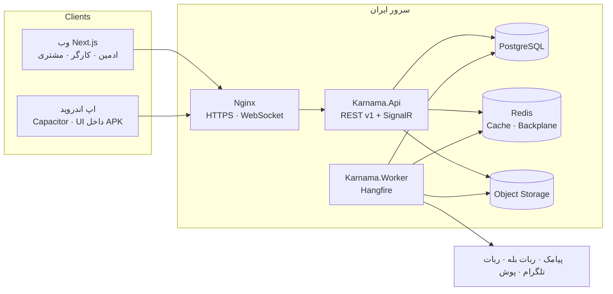
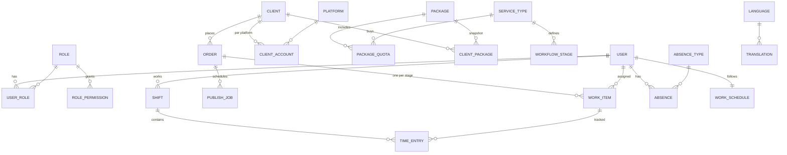
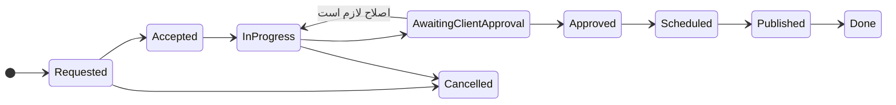
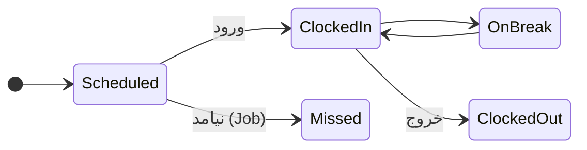
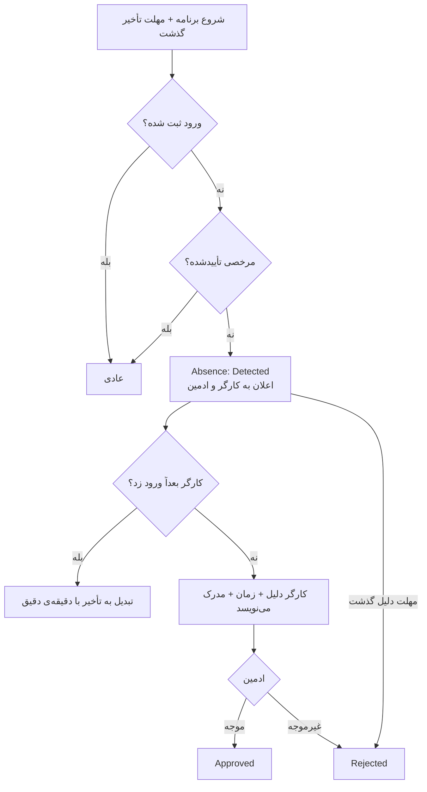

# نقشه‌ی پروژه — کارنما

> **هر جلسه اول فقط همین فایل را بخوان.** بعد از هر کار به‌روزش کن و `python tools/build_map.py` بزن.
> آخرین به‌روزرسانی: ۳ آبان ۱۴۰۵ — وضعیت: **آماده‌ی شروع M1**

## وضعیت مراحل

| مرحله | عنوان | فاز قرارداد | وضعیت |
|---|---|---|---|
| M0 | پرامپت، اسکیل‌ها، نقشه، اسکلت پوشه | — | ✅ انجام شد |
| M1 | اسکلت + Auth + نقش‌های دینامیک + زیرساخت زبان + CI | کنترل داخلی | ⬜ بعدی |
| M2 | داده‌ی پایه + CRUD ادمین + پکیج‌های فروش | کنترل داخلی | ⬜ |
| M3 | سفارش، کار، کانبان لایو، آپلود قابل ادامه | کنترل داخلی | ⬜ |
| M4 | ساعت کار دقیق (شیفت، تایمر، آفلاین، اصلاح) | کنترل داخلی | ⬜ |
| M5 | غیبت، مرخصی، تأخیر | کنترل داخلی | ⬜ |
| M6 | پورتال مشتری، انتشار، اعلان‌ها و ربات‌ها | کنترل داخلی | ⬜ |
| M7 | اندروید، ۱۰ اسکیل امنیتی، k6، 3G، دیپلوی ایران | کنترل داخلی ← **تحویل فاز ۱** | ⬜ |
| M8 | زبان‌ها، تبلیغات، گزارش ماهانه، صفحه‌ی عمومی | برنامه‌ی کامل | ⬜ |
| M9 | گزارش‌ها و داشبوردها | برنامه‌ی کامل | ⬜ |
| M10 | انتشار خودکار بله/تلگرام، پرداخت قرارداد، سود مشتری | برنامه‌ی کامل | ⬜ |

## قدم بعدی

**M1:** ساخت Solution طبق `docs/PROMPT.md` بخش ۴ و ۱۶. قبلش اسکیل‌های `docs/SECURITY_SKILLS.md` (۳، ۴، ۷) و `dotnet-skills` را بعد از خواندن فایل‌هایشان نصب کن.

## فایل‌های مهم

| فایل | چیست |
|---|---|
| `CLAUDE.md` | قوانین برای AI |
| `docs/PROMPT.md` | پرامپت کامل پروژه |
| `docs/SKILLS.md` | همه‌ی استانداردهای امیر |
| `docs/SECURITY_SKILLS.md` | ۱۰ اسکیل امنیتی + نصب |
| `docs/21st-components.md` | ثبت هر کامپوننت 21st |
| `docs/CANVA_ASSETS.md` | گرافیک‌های کانوا |
| `.env.example` | همه‌ی تنظیمات (بدون مقدار) |

## معماری

## موجودیت‌های اصلی (ERD خلاصه)

## ماشین‌های وضعیت

## سناریوی غیبت

## لاگ تصمیم‌ها

| تاریخ | تصمیم | دلیل |
|---|---|---|
| ۱۴۰۵/۰۸/۰۳ | PostgreSQL به‌جای SQL Server | بدون هزینه‌ی لایسنس روی سرور ایران |
| ۱۴۰۵/۰۸/۰۳ | اندروید با Capacitor 8 روی همان Next.js | یک کد UI، قانون «فقط 21st» در اپ هم حفظ می‌شود، پروژه‌ی واقعی Android Studio |
| ۱۴۰۵/۰۸/۰۳ | Refresh Token اپ در Keystore، نه کوکی | کوکی SameSite در WebView اپ کار نمی‌کند |
| ۱۴۰۵/۰۸/۰۳ | SignalR + MessagePack + Delta + Cursor | لایو با داده‌ی کم و همگام‌سازی بعد از قطع |
| ۱۴۰۵/۰۸/۰۳ | زمان مرجع حضور = ساعت سرور | دقت و جلوگیری از دستکاری ساعت گوشی |
| ۱۴۰۵/۰۸/۰۳ | پوش فقط با آداپتر و هرگز تنها کانال | پایداری سرویس‌های پوش در ایران نامطمئن است |
| ۱۴۰۵/۰۸/۰۳ | `AlexDevFlow/Claude10XD` حذف شد | ریپو عمومی نیست؛ جایگزین با اسکیل‌های Sentry، OWASP و Trail of Bits |

## سؤال‌های باز

1. کارگرها حضوری‌اند یا دورکار؟
2. ساعت کاری ثابت یا شناور؟ روزهای کاری؟
3. انواع مرخصی، سقف‌ها، مدرک استعلاجی؟
4. پیام‌رسان اصلی (بله / تلگرام / واتساپ)؟
5. اسم و لوگوی برند، دامنه، حساب کافه‌بازار؟
6. فهرست پکیج‌های فعلی (Seed واقعی، خارج از ریپو)؟
7. هماهنگی با CRM آکادمی معین فرجی لازم است؟
