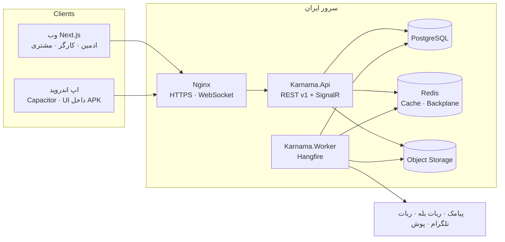
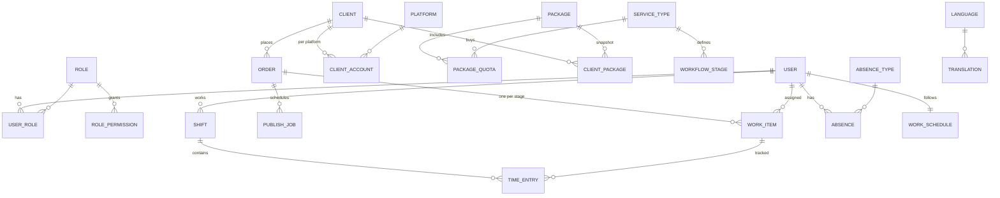
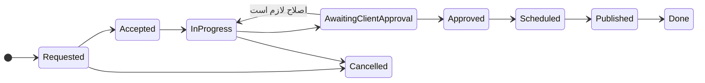
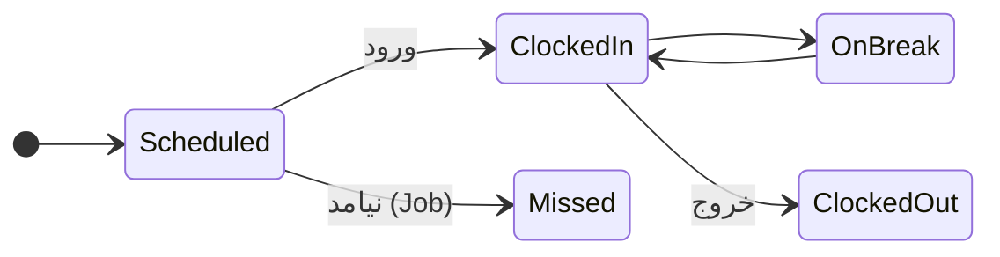
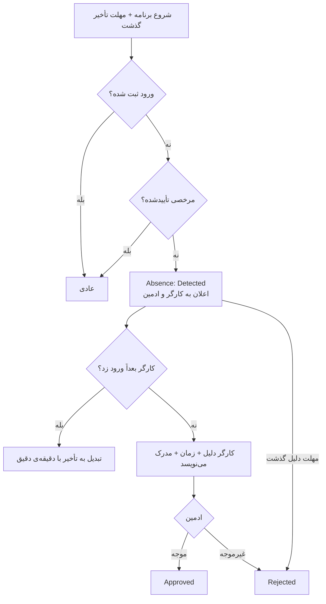

# نقشه‌ی پروژه — کارنما

> **هر جلسه اول فقط همین فایل را بخوان.** بعد از هر کار به‌روزش کن و `python tools/build_map.py` بزن.
> آخرین به‌روزرسانی: ۳ آبان ۱۴۰۵ — وضعیت: **M1 سبز ✅ — آماده‌ی M2**

## وضعیت مراحل

| مرحله | عنوان | فاز قرارداد | وضعیت |
|---|---|---|---|
| M0 | پرامپت، اسکیل‌ها، نقشه، اسکلت پوشه | — | ✅ انجام شد |
| M1 | اسکلت + Auth + نقش‌های دینامیک + زیرساخت زبان + CI | کنترل داخلی | ✅ انجام شد |
| M2 | داده‌ی پایه + CRUD ادمین + پکیج‌های فروش | کنترل داخلی | ⬜ بعدی |
| M3 | سفارش، کار، کانبان لایو، آپلود قابل ادامه | کنترل داخلی | ⬜ |
| M4 | ساعت کار دقیق (شیفت، تایمر، آفلاین، اصلاح) | کنترل داخلی | ⬜ |
| M5 | غیبت، مرخصی، تأخیر | کنترل داخلی | ⬜ |
| M6 | پورتال مشتری، انتشار، اعلان‌ها و ربات‌ها | کنترل داخلی | ⬜ |
| M7 | اندروید، ۱۰ اسکیل امنیتی، k6، 3G، دیپلوی ایران | کنترل داخلی ← **تحویل فاز ۱** | ⬜ |
| M8 | زبان‌ها، تبلیغات، گزارش ماهانه، صفحه‌ی عمومی | برنامه‌ی کامل | ⬜ |
| M9 | گزارش‌ها و داشبوردها | برنامه‌ی کامل | ⬜ |
| M10 | انتشار خودکار بله/تلگرام، پرداخت قرارداد، سود مشتری | برنامه‌ی کامل | ⬜ |

## M1 — چه ساخته شد

- **بک‌اند (.NET 10 LTS):** `Karnama.Domain / Application / Infrastructure / Api / Worker`، PostgreSQL (EF Core + Npgsql، `xmin`)، Redis (اختیاری در Development، اجباری در Production).
- **ورود:** موبایل + OTP (HMAC، ۲ دقیقه، ۵ تلاش اتمیک، ۳ ارسال/۱۰ دقیقه، ۶۰ ثانیه فاصله، ارسال پیامک در صف پس‌زمینه)، JWT ۱۵ دقیقه، Refresh چرخشی با تشخیص استفاده‌ی مجدد (وب: کوکی HttpOnly؛ اندروید: هدر `X-Refresh-Token`)، **۲FA اجباری مالک (TOTP)**، ورود سریع دمو (فقط Development).
- **نقش‌ها و مجوزها:** کاتالوگ ۲۹ مجوز با دامنه‌ی Own/Assigned/All، نقش‌های سیستمی مالک/مشتری، CRUD نقش‌ها با حذف نرم، برگرداندن، همزمانی (409)، Audit تغییرناپذیر (Trigger)، اعلان لایو تغییر نقش با SignalR (MessagePack).
- **چندزبانه:** جدول `Languages` و `Translations`، `/api/v1/i18n/{code}` با ETag/304، فارسی پیش‌فرض داخل باندل، انگلیسی lazy، تغییر `dir` بدون رفرش، تاریخ شمسی و ارقام فارسی.
- **راه‌اندازی:** `/setup` با کد نصب (ثابت‌زمان، تراکنشی، فقط یک بار، در نصب دمو رد می‌شود).
- **فرانت (Next.js 16):** `/login`، `/setup`، `/dashboard`، `/roles` (جدول دسکتاپ + کارت موبایل + Sheet فرم + تأیید حذف داخل صفحه + برگرداندن ۱۰ ثانیه‌ای)، `/profile` (زبان، تم روشن/تیره)، ۴۰۴، نوار آفلاین، نوار دمو + تغییر نقش، سایدبار جمع‌شونده + Bottom Nav. خروجی استاتیک اندروید (`npm run build:mobile`) هم build می‌شود.
- **تست:** ۳۴ Unit + ۲۲ Integration (PostgreSQL واقعی؛ Testcontainers یا `KARNAMA_TEST_PG`) + ۱۶ سناریوی تصویری Playwright روی ۱۳۶۶ / Pixel 7 / ۳۶۰px (`tests/e2e/run-visual.sh`).
- **CI:** `.github/workflows/ci.yml` (build، test، پکیج آسیب‌پذیر، npm audit، lint، type، بودجه‌ی JS، build اندروید) و `codeql.yml`.
- **امنیت:** `docs/security/2026-10-25-m1-review.md` — ۴ Medium و ۴ Low پیدا و اصلاح شد.
- **White-label (خواسته‌ی امیر):** صفحه‌ی «برند و ظاهر» (نام، شعار، لوگو با بررسی Magic Bytes، رنگ اصلی/تیره/تأکید با تضمین خوانایی WCAG، پیش‌نمایش زنده) و «متن‌های سایت» (هر متن هر زبان، جستجو، برگرداندن به پیش‌فرض). رنگ پیش‌فرض: مشکی `#0A0A0A` + زرد `#FEFF00` (پرامپت دوم).
- **آیفون (PWA):** manifest دینامیک از برند، Service Worker (پوسته‌ی آفلاین، API هرگز کش نمی‌شود)، آیکون‌ها، راهنمای «Add to Home Screen». نقشه‌ی کامل موبایل: `docs/MOBILE.md`.
- **بودجه‌ی JS:** tailwind-merge (~۹KB) با یک `cn` یک‌کیلوبایتی جایگزین شد (تست هم‌خوانی: `scripts/cn-parity.mts`) → همه‌ی صفحه‌ها ۱۶۸–۱۷۵KB.

## پرامپت دوم (`docs/PROMPT2.md`) — مراحل N1 تا N12

| مرحله | عنوان | وضعیت |
|---|---|---|
| N0 | قانون‌های سراسری: «سایت = وب + اپ»، راهنمای ساده زیر همه‌چیز، **رنگ برند مشکی/زرد**، Audit دیدن داده‌ی حساس | 🟡 رنگ برند اعمال شد (M1)؛ بقیه در هر مرحله |
| N1 | روش‌های ورود و سیاست‌ها (داخل M4) | ⬜ |
| N2 | دستگاه اثر انگشت (ADMS + فایل) | ⬜ |
| N3 | تجهیزات | ⬜ |
| N4 | پکیج کامل + گاوصندوق رمز + پروفایل مشتری + پیام انقضا (با M2) | ⬜ |
| N5 | ربات تلگرام (Gateway بیرون ایران) + آداپتر بله | ⬜ |
| N6 | گفتگو | ⬜ |
| N7 | CRM و بازاریاب‌ها | ⬜ |
| N8 | گزارش بازه‌ای + امتیازدهی | ⬜ |
| N9 | ویرایشگر Tiptap + بلاگ (**سئوی خودکار** — بخش ۱۸) + مرکز راهنما | ⬜ |
| N10 | صفحه‌ی اصلی با سئو + نمونه‌کارها + `docs/SEO.md` | ⬜ |
| N11 | دوربین مداربسته | ⬜ |
| N12 | راهنمای استفاده + سخت‌سازی نهایی + دیپلوی | ⬜ |

**ترتیب ادغام:** M2 (+N4 پکیج کامل) → M3 → M4 (+N1) → M5 → M6 → N9/N10 (بلاگ و سایت با سئوی خودکار) → بقیه. امیر گفته بدون اجازه‌گرفتن جلو برویم.

## قدم بعدی

**M2:** داده‌ی پایه + CRUD ادمین (کاربران و تخصیص نقش با قانون «حداقل یک مالک»، مشتری‌ها، شبکه‌ها، انواع خدمت با فرم‌ساز و مراحل، پکیج‌ها با توضیحات Sanitize‌شده و سهمیه، تنظیمات White-label، دستیار راه‌اندازی). قبلش:
1. کلید 21st را در `.env` بگذار (`TWENTYFIRST_API_KEY`) تا جایگزین‌های موقت عوض شوند (`docs/21st-components.md`).
2. بودجه‌ی JS: فریم‌ورک Next 16 + React به‌تنهایی ~۱۲۸KB است؛ هر صفحه‌ی سنگین (ویرایشگر، کانبان، نمودار) باید lazy باشد. لیست‌ها از `useKeysetList` استفاده کنند.

### نسخه‌ی دمو برای مشتری (خواسته‌ی امیر ۱۲:۵۳)
اول **نسخه‌ی دمو** = M1 + M2 + M3 + M4 (با N1) + پورتال سادهٔ مشتری → برای مشتری فرستاده می‌شود؛ بعد نسخه‌ی اصلی با بقیه‌ی مراحل و اصلاح‌های بازخورد. گزارش کوتاه هر نیم ساعت.

## فایل‌های مهم

| فایل | چیست |
|---|---|
| `CLAUDE.md` | قوانین برای AI |
| `docs/PROMPT.md` | پرامپت کامل پروژه |
| `docs/SKILLS.md` | همه‌ی استانداردهای امیر |
| `docs/SECURITY_SKILLS.md` | ۱۰ اسکیل امنیتی + نصب |
| `docs/21st-components.md` | ثبت هر کامپوننت 21st |
| `docs/CANVA_ASSETS.md` | گرافیک‌های کانوا |
| `.env.example` | همه‌ی تنظیمات (بدون مقدار) — `python tools/new-env.py` کلیدها را می‌سازد |
| `docs/security/` | گزارش اسکیل‌های امنیتی هر مرحله |
| `src/Karnama.Api/Program.cs` | پیکربندی API (Auth، CORS، RateLimit، SignalR، Health) |
| `src/Karnama.Application/Auth/AuthService.cs` | OTP، ۲FA، Refresh، دمو |
| `src/Karnama.Domain/Identity/Permissions.cs` | کاتالوگ مجوزها (تنها جای افزودن مجوز) |
| `src/karnama-web/src/lib/` | api، auth، i18n، تم، realtime |
| `tests/e2e/run-visual.sh` (+ `.cmd`) | تست تصویری دمو + نصب خالی |
| `tools/bundle-size.mjs` | بودجه‌ی JS (اول ۲۰۰، پنل‌ها ۱۸۰KB gzip) |

## معماری

## موجودیت‌های اصلی (ERD خلاصه)

## ماشین‌های وضعیت

## سناریوی غیبت

## لاگ تصمیم‌ها

| تاریخ | تصمیم | دلیل |
|---|---|---|
| ۱۴۰۵/۰۸/۰۳ | PostgreSQL به‌جای SQL Server | بدون هزینه‌ی لایسنس روی سرور ایران |
| ۱۴۰۵/۰۸/۰۳ | اندروید با Capacitor 8 روی همان Next.js | یک کد UI، قانون «فقط 21st» در اپ هم حفظ می‌شود، پروژه‌ی واقعی Android Studio |
| ۱۴۰۵/۰۸/۰۳ | Refresh Token اپ در Keystore، نه کوکی | کوکی SameSite در WebView اپ کار نمی‌کند |
| ۱۴۰۵/۰۸/۰۳ | SignalR + MessagePack + Delta + Cursor | لایو با داده‌ی کم و همگام‌سازی بعد از قطع |
| ۱۴۰۵/۰۸/۰۳ | زمان مرجع حضور = ساعت سرور | دقت و جلوگیری از دستکاری ساعت گوشی |
| ۱۴۰۵/۰۸/۰۳ | پوش فقط با آداپتر و هرگز تنها کانال | پایداری سرویس‌های پوش در ایران نامطمئن است |
| ۱۴۰۵/۰۸/۰۳ | `AlexDevFlow/Claude10XD` حذف شد | ریپو عمومی نیست؛ جایگزین با اسکیل‌های Sentry، OWASP و Trail of Bits |
| ۱۴۰۵/۰۸/۰۳ | **.NET 10 LTS** به‌جای .NET 9 | پشتیبانی .NET 9 در ۱۰ نوامبر ۲۰۲۶ (۲۰ آبان ۱۴۰۵) تمام می‌شود؛ .NET 10 تا نوامبر ۲۰۲۸ |
| ۱۴۰۵/۰۸/۰۳ | Next.js 16.4 + React 19.3 + Tailwind 4.3 + Capacitor 8.5 | آخرین نسخه‌های پایدار در زمان شروع |
| ۱۴۰۵/۰۸/۰۳ | UI موقت از shadcn/ui (فایل‌ها با «TEMPORARY STAND-IN») | کلید 21st نبود؛ نصب 21st بدون کلید ممکن نیست |
| ۱۴۰۵/۰۸/۰۳ | sonner، فرم نقش، منوی دمو، qrcode و زبان انگلیسی lazy؛ next-themes با ۱KB کد خودمان؛ shadcn sidebar/table حذف | بودجه‌ی ۱۸۰KB پنل‌ها |
| ۱۴۰۵/۰۸/۰۳ | خطای OTP حساب را قفل نمی‌کند؛ قفل فقط روی TOTP | جلوگیری از قفل‌کردن مالک توسط غریبه (DoS) |
| ۱۴۰۵/۰۸/۰۳ | ارسال پیامک OTP در صف حافظه (نه Outbox) | کد ۲ دقیقه عمر دارد و نباید روی دیسک بماند؛ پاسخ HTTP یکسان برای همه |
| ۱۴۰۵/۰۸/۰۳ | دکمه‌های ورود دمو ۲×۲ (نه یک ردیف) در دسکتاپ | ستون فرم باریک است و توضیح هر نقش خوانا می‌ماند |
| ۱۴۰۵/۰۸/۰۳ | CSP با `script-src 'unsafe-inline'` | صفحات استاتیک Next اسکریپت درون‌خطی دارند؛ nonce فقط با رندر پویا |
| ۱۴۰۵/۰۸/۰۳ | `/setup` در نصب دمو غیرفعال | مالک واقعی هرگز کنار حساب‌های دمو نباشد |
| ۱۴۰۵/۰۸/۰۳ | ادمین فقط ۲ رنگ (+تأکید اختیاری) انتخاب می‌کند؛ بقیه خودکار با کنتراست ۴٫۵:۱ | هیچ انتخابی سایت را ناخوانا نکند (زرد روی سفید) |
| ۱۴۰۵/۰۸/۰۳ | محدودیت refresh جدا (۳۰۰/دقیقه/IP) | کل دفتر پشت یک IP صبح‌ها با هم وارد می‌شوند |
| ۱۴۰۵/۰۸/۰۳ | `cn` داخلی به‌جای tailwind-merge | ۹KB کمتر روی هر صفحه برای اینترنت ضعیف |
| ۱۴۰۵/۰۸/۰۳ | آیفون = PWA (نه اپ بومی) | اپ‌استور برای ایران ممکن نیست؛ محدودیت‌ها و جایگزین‌ها در `docs/MOBILE.md` |

## سؤال‌های باز

1. کارگرها حضوری‌اند یا دورکار؟
2. ساعت کاری ثابت یا شناور؟ روزهای کاری؟
3. انواع مرخصی، سقف‌ها، مدرک استعلاجی؟
4. پیام‌رسان اصلی (بله / تلگرام / واتساپ)؟
5. اسم و لوگوی برند، دامنه، حساب کافه‌بازار؟
6. فهرست پکیج‌های فعلی (Seed واقعی، خارج از ریپو)؟
7. هماهنگی با CRM آکادمی معین فرجی لازم است؟
8. کلید 21st.dev (پلن رایگان سقف نصب روزانه دارد) — چه کسی حساب می‌سازد؟
9. سرویس پیامک: کاوه‌نگار یا sms.ir؟ (نام قالب OTP لازم است)
